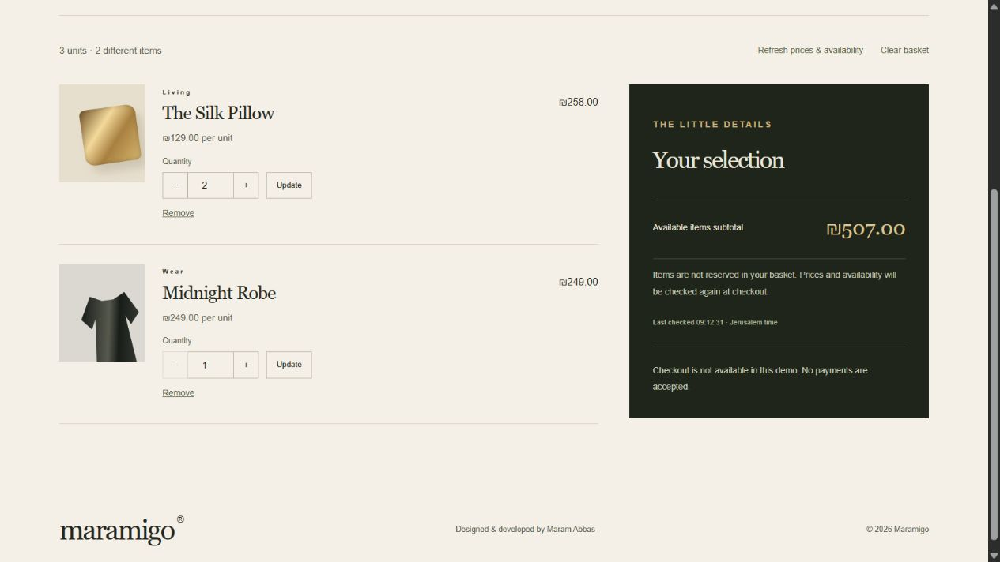
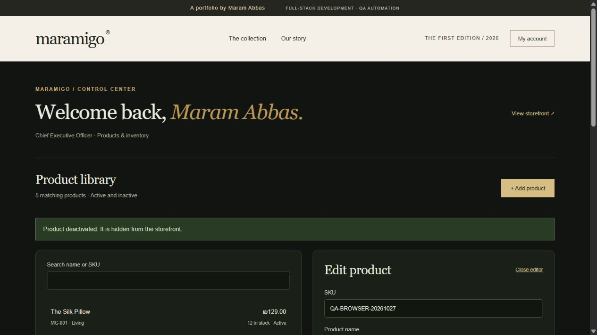

# Maramigo

A luxury storefront and inventory/order-management portfolio project by **Maram Abbas**.
Java Spring Boot · React · TypeScript · PostgreSQL · Selenium Java automation.


## Current build

Owner and employee areas are now separate from customer accounts. Use **Sign in → Site owner** (`#owner-login`) for the single preconfigured owner and **Employees** (`#staff-login`) for invited staff. The owner workspace (`#owner`) saves business details, issues email-bound one-time invitations and enables/disables employees. Employees see delivery details and can mark orders shipped/delivered; they cannot access financial dashboards, edit prices/stock, cancel orders or manage accounts. See [owner/staff contract](docs/OWNER_STAFF_CONTRACT.md). Business registration details are self-reported, and real payment collection is not connected.

Implemented and locally verified: catalog API with search, categories, sorting and pagination; PostgreSQL migrations and demo data; storefront and product details; registration, session login/logout, CSRF and role enforcement; administrator product creation/editing/deactivation; audited stock adjustments and stale-update protection; a persistent browser basket with quantities, current prices, availability checks and same-origin tab synchronization. Original scalable CSS illustrations are used for products. Also implemented: Hebrew/Arabic/English with RTL/LTR layout, three fictional demo stores with separate catalogs, authentication before adding, transactional demo checkout, owned order history and printable confirmation.

Also implemented: administrator order search/filter/detail, audited status changes and atomic cancellation with inventory restoration. See [the admin order contract](docs/ADMIN_ORDER_CONTRACT.md).

The administrator Dashboard now provides a Jerusalem-date-filtered order summary, daily Recharts graph, current low-stock alerts and automatic refresh with last-successful-update time. See [the dashboard contract](docs/DASHBOARD_CONTRACT.md).

Implemented Selenium: six public smoke cases, six purchase cases, six accessibility-matrix cases and two owner/employee cases, with Page Objects, isolated customer/product fixtures, desktop/mobile checkout, price snapshots, last-unit protection and customer/admin browsers. Full runs create and remove a disposable schema and separate application. [Automation guide](automation/README.md) · [purchase verification](docs/PURCHASE_AUTOMATION.md). The [126-sample accessibility matrix](docs/ACCESSIBILITY_MATRIX.md) covers 21 rendered states in three languages at desktop/mobile widths; screen-reader, zoom and additional device review remain pending. The GitHub workflow validates source/workflow safety, Java/PostgreSQL, frontend lint/types/tests/build and isolated Chrome purchase journeys. [Live runs and artifacts](https://github.com/marambadarne2000/Maramigo/actions) · [CI guide](docs/CI.md). No payments are accepted. See [the numbered Hebrew plan](WORK_PLAN_HE.md), [architecture decisions](docs/ARCHITECTURE.md), [product-management API contract](docs/PRODUCT_ADMIN_CONTRACT.md) and [basket contract](docs/CART_CONTRACT.md).



Add products from the collection or product details and open **Basket**. Only IDs and quantities are stored locally (50 lines, 99 units per line). Current prices and stock come from the server; adding to a basket does not reserve inventory. Refresh flags price changes, insufficient stock, sold-out or deactivated products. The subtotal includes available lines only. Basket data survives reload and sign-in; adding while signed out opens the sign-in page and resumes the addition once after login. Checkout creates a demo order, deducts stock atomically and clears only purchased quantities after confirmation. See [the order contract](docs/ORDER_CONTRACT.md).



For product management, use Owner sign-in with the generated owner credentials, open **My account → Product management**. Product metadata and stock changes are separate actions; stock adjustments require a reason. The server rejects stale edits rather than overwriting another administrator's work. Products are deactivated, never hard-deleted.

## Windows without Docker (the verified local route)

For a fresh installation, follow the complete [Windows setup and troubleshooting
guide](docs/FRESH_SETUP.md). [Backup/recovery instructions](docs/RECOVERY.md)
cover local snapshots, checksum verification and isolated restore tests.

Requires PowerShell 7, JDK 17, Maven, Node and installed npm dependencies. On the authoring machine, portable PostgreSQL and Maven have already been prepared in ignored `.tools/`.

```powershell
# From the maramigo folder, in PowerShell 7:
./scripts/Start-Local.ps1
# Rebuild after changing Java code (stops only this project's processes first):
./scripts/Start-Local.ps1 -Restart -Build
# Verification against real PostgreSQL, plus frontend build:
./scripts/Check.ps1 -Integration
# Include Selenium against the running local app:
./scripts/Check.ps1 -Integration -Automation
# Rehearse all CI checks locally (includes isolated full Selenium):
./scripts/Check-CI.ps1
# Full browser suite using a disposable database schema and separate servers:
./scripts/Test-Automation.ps1 -Full
# Stop while preserving data:
./scripts/Stop-Local.ps1
```

Open http://127.0.0.1:5173. Local PostgreSQL listens only on 127.0.0.1:55432; backend only on 127.0.0.1:8080. Startup checks both backend health and the frontend response.

On a fresh Windows machine, run `scripts/Setup-PortablePostgres.ps1` once. It downloads the vendor's portable PostgreSQL 17.11 archive, verifies the published SHA-256 and extracts server files only. [Vendor binaries](https://www.enterprisedb.com/download-postgresql-binaries) · [vendor checksum](https://github.com/EnterpriseDB/edb-installers/issues/682).

The database credentials and generated demo administrator credentials (`demoAdminEmail`, `demoAdminPassword`) are in ignored `.runtime/local.json`. Never commit or publish this file. Customer accounts can be created through the storefront using synthetic information. Demo admin bootstrap never promotes an existing customer or resets an existing password. This is a local HTTP demo; secure cookies are disabled explicitly only for local startup/Compose. HTTPS deployment keeps Secure cookies enabled by default.

## Local demo using Docker

Requires Docker Engine with Compose and internet access for image/dependency downloads.

From this directory in PowerShell:

```powershell
Copy-Item .env.example .env
# Edit .env and set a local demo password before starting.
docker compose up --build
```

Storefront: http://localhost:8088 · API: http://localhost:8080/api/products · Health: http://localhost:8080/actuator/health

Stop: `docker compose down`. Database data remains in the named volume. **`docker compose down -v` deletes the demo database.** Never use the volume deletion command against data you need.

## Development

Backend: JDK 17 and Maven 3.6.3+; PostgreSQL 17. Set `DB_URL`, `DB_USER`, `DB_PASSWORD` and optionally `SPRING_PROFILES_ACTIVE=demo`, then run `mvn spring-boot:run` from `backend/`.

Frontend: Node 22.13+ or 24+ for the complete pinned toolchain (including lint), with Node 22 used in CI. Windows can prepare the checksum-verified local runtime with `scripts/Setup-PortableNode.ps1`. From `frontend/`, install dependencies with `npm ci`, then `npm run dev`. The development proxy forwards `/api` to localhost:8080. The app does not invent fallback catalog data when the backend is unavailable.

Windows shortcuts: `scripts/Start-Demo.ps1` starts Compose after checking prerequisites; `scripts/Check.ps1` runs backend tests and the frontend build; add `-Integration` for PostgreSQL integration tests. The authoring machine has a project-local Maven under `.tools/`, ignored by Git. Other machines need Maven installed.

## Verification

Java dependency security: `./scripts/Audit-Java.ps1` resolves backend and automation
dependencies and queries OSV. The [review](docs/DEPENDENCY_SECURITY.md) records
maintenance updates and two findings on unused Spring rendering paths, retained
with exact-version reviews expiring 2026-11-27. Reports distinguish a clean scan
from a pass with reviewed findings. Network or inventory failures fail the check.

```powershell
cd backend
mvn test
mvn verify -Pintegration # Docker, or explicit TEST_DB_* settings; stop the Windows demo first to release its JAR
cd ../frontend
npm run typecheck
npm test
npm run build
```

Integration tests use a PostgreSQL container by default. Set `TEST_DB_URL`, `TEST_DB_USER` and `TEST_DB_PASSWORD` to use an explicitly authorized local test server instead. Each suite creates and drops its own randomly named schema and does not alter demo tables. `Check.ps1 -Integration` detects the project's portable local database automatically. Never point test credentials at production.

Verified: 7 unit/MVC tests, 38 PostgreSQL/HTTP integration tests, 27 frontend model/localization/usability tests and 20 Chrome Selenium cases (92 total). Backend tests cover roles/CSRF, invalid inputs, audit, stale versions, concurrent updates and bounded active-product lookup. Basket tests cover persistence validation, limits, stock checks, exact agorot arithmetic and malformed product data. Order tests cover atomic rollback, ownership, price snapshots, concurrent last-unit purchases, idempotency, stale order updates, allowed delivery transitions, concurrent cancellations and overflow rollback, dashboard date boundaries, empty dates, cancellation exclusion and stock adjustment competing with checkout. Browser checks include three-language switching, company isolation, login-before-add, completed checkout and basket add/merge/quantity/removal/clear, reload, two-tab synchronization, customer sign-in preservation, price changes, insufficient stock, zero stock and deactivation. Use `scripts/Smoke-Local.ps1` to verify the running proxy and demo administrator session. Both Selenium smoke and isolated purchase/customer/admin journeys have run locally. GitHub-hosted results are available on the Actions page; the Docker Compose demo has not been verified locally.

See [verification status](docs/STATUS_HE.md) for what has actually run in the authoring environment. This is an initial build, not a completed application or a production deployment.
