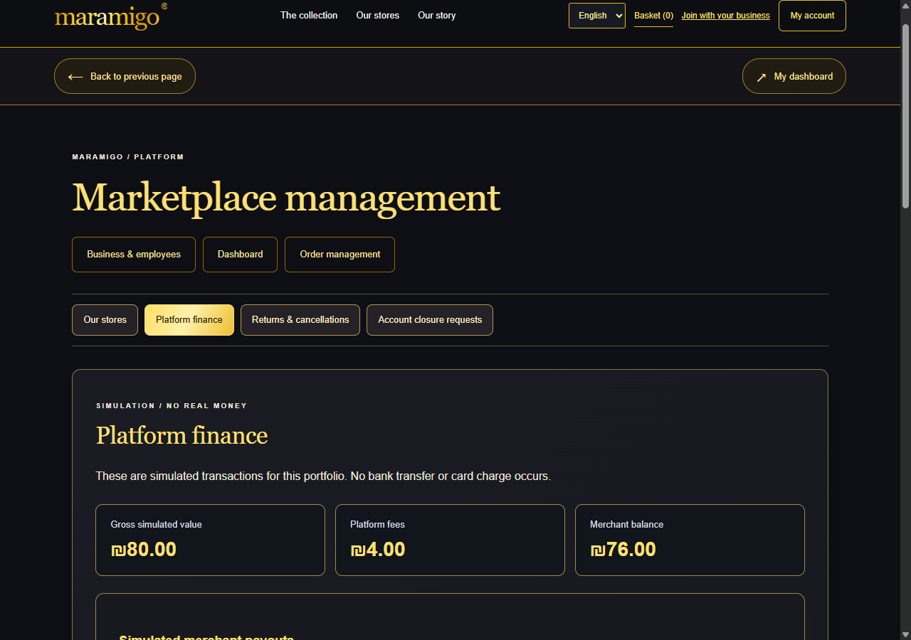

# Mavelle

A connected full-stack marketplace and QA automation portfolio by **Maram Abbas**.

**Java 17 · Spring Boot · React · TypeScript · PostgreSQL · Selenium WebDriver · JUnit · GitHub Actions**

Mavelle combines customer shopping, independent merchant workspaces, a sole platform-owner dashboard and invited fulfilment employees. The backend enforces tenant and role isolation; the UI supports Hebrew, Arabic and English with RTL/LTR, classic black/gold styling and responsive layouts.

[Full system inventory and pre-launch audit (Hebrew)](SYSTEM_AUDIT_HE.md)

## What you can demonstrate

- Private platform support for customers, merchants and employees: owner replies, resolution/reopening, paged threads, quotas, scoped export and closure redaction.
- An account-scoped updates inbox for order, delivery, store, message and support records, with persistent read receipts and visible-page refresh.
- Five real manufacturer reference catalogs (Apple, Sony, Logitech, LEGO, IKEA), twenty actual product models, local matching photos, specifications and official source links. Prices/stock remain explicitly synthetic; no brand partnership is claimed. See [provenance and attribution](docs/catalog/README.md).
- Merchant application/approval, private catalog and stock management, safe product-photo/logo upload, store search and pagination.
- Login-before-basket, saved shipping details, declined/successful simulated checkout, inventory locking, stable price/store snapshots and idempotent requests.
- Mixed-store fulfilment, customer cancellation/returns, merchant/owner decisions, exactly-once stock restoration and matching simulated refunds.
- Demo subscriptions, 5% commission, per-store balances, an immutable transaction journal and idempotent simulated payouts. **No real card, bank transfer, tax invoice or payment-provider sandbox is connected.**
- Email verification/recovery, authenticated password/email changes, owner TOTP/recovery codes, session revocation, scoped data export and reviewed account closure.
- A durable local mail-request queue, explicit public announcements, customer favorites, private purchased-store conversations and delivered-order feedback.



## Review and run

- [Numbered Hebrew demo walkthrough](docs/DEMO_WALKTHROUGH_HE.md)
- [Requirement matrix and honest remaining launch dependencies](REQUIREMENTS_AUDIT_HE.md)
- [Connected workflow/API notes](docs/PORTFOLIO_RELEASE_HE.md)
- [Account security and email-delivery configuration](docs/ACCOUNT_SECURITY_HE.md)
- [CV description and interview walkthrough](docs/CV_PROJECT_EN.md)
- [CI and evidence](docs/CI.md) · [Architecture](docs/ARCHITECTURE.md)

After setup, run `./scripts/Start-Local.ps1 -Restart` or double-click `RUN_LOCAL.cmd`. Open **http://127.0.0.1:5173/#home**. Use fictional information. Normal owner credentials and data are preserved; tests use isolated schemas.

Source packaging: commit the reviewed code, then run `./scripts/Package-Portfolio.ps1`. The ZIP contains only tracked source from that commit, with no local users, keys, mail, uploaded media or tools.

The suite includes 87 backend cases (13 unit/MVC and 74 PostgreSQL/HTTP), 40 frontend cases and 26 Selenium cases. Read the completed reports for the exact revision; a count is not a coverage percentage or proof that every possible defect is absent.

SMTP delivery, real payment/business onboarding, a public HTTPS deployment and production legal/security/operational acceptance remain external launch work. Docker Compose is prepared but has not been executed on this machine because Docker is unavailable.

## Windows without Docker (the verified local route)

For a fresh installation, follow the complete [Windows setup and troubleshooting
guide](docs/FRESH_SETUP.md). [Backup/recovery instructions](docs/RECOVERY.md)
cover local snapshots, checksum verification and isolated restore tests.

Requires PowerShell 7, JDK 17, Maven, Node and installed npm dependencies. On the authoring machine, portable PostgreSQL and Maven have already been prepared in ignored `.tools/`.

```powershell
# From the maramigo folder, in PowerShell 7:
./scripts/Start-Local.ps1
# Rebuild after changing Java code (stops only this project's processes first):
./scripts/Start-Local.ps1 -Restart -Build
# Verification against real PostgreSQL, plus frontend build:
./scripts/Check.ps1 -Integration
# Include Selenium against the running local app:
./scripts/Check.ps1 -Integration -Automation
# Rehearse all CI checks locally (includes isolated full Selenium):
./scripts/Check-CI.ps1
# Full browser suite using a disposable database schema and separate servers:
./scripts/Test-Automation.ps1 -Full
# Stop while preserving data:
./scripts/Stop-Local.ps1
```

Open http://127.0.0.1:5173. Local PostgreSQL listens only on 127.0.0.1:55432; backend only on 127.0.0.1:8080. Startup checks both backend health and the frontend response.

On a fresh Windows machine, run `scripts/Setup-PortablePostgres.ps1` once. It downloads the vendor's portable PostgreSQL 17.11 archive, verifies the published SHA-256 and extracts server files only. [Vendor binaries](https://www.enterprisedb.com/download-postgresql-binaries) · [vendor checksum](https://github.com/EnterpriseDB/edb-installers/issues/682).

The database credentials and generated demo administrator credentials (`demoAdminEmail`, `demoAdminPassword`) are in ignored `.runtime/local.json`. Never commit or publish this file. Customer accounts can be created through the storefront using synthetic information. Demo admin bootstrap never promotes an existing customer or resets an existing password. This is a local HTTP demo; secure cookies are disabled explicitly only for local startup/Compose. HTTPS deployment keeps Secure cookies enabled by default.

## Local demo using Docker

Requires Docker Engine with Compose and internet access for image/dependency downloads.

From this directory in PowerShell:

```powershell
Copy-Item .env.example .env
# Edit .env: use unique demo DB/owner passwords; set ACCOUNT_ENCRYPTION_KEY for owner MFA.
docker compose up --build
```

Docker has not been run on the authoring machine. Its local mail volume is private; ACCOUNT_PUBLIC_URL defaults to the Docker storefront port 8088.

Storefront: http://localhost:8088 · API: http://localhost:8080/api/products · Health: http://localhost:8080/actuator/health

Stop: `docker compose down`. Database data remains in the named volume. **`docker compose down -v` deletes the demo database.** Never use the volume deletion command against data you need.

## Development

Backend: JDK 17 and Maven 3.6.3+; PostgreSQL 17. Set `DB_URL`, `DB_USER`, `DB_PASSWORD` and optionally `SPRING_PROFILES_ACTIVE=demo,real-catalog`, then run `mvn spring-boot:run` from `backend/`.

Frontend: Node 22.13+ or 24+ for the complete pinned toolchain (including lint), with Node 22 used in CI. Windows can prepare the checksum-verified local runtime with `scripts/Setup-PortableNode.ps1`. From `frontend/`, install dependencies with `npm ci`, then `npm run dev`. The development proxy forwards `/api` to localhost:8080. The app does not invent fallback catalog data when the backend is unavailable.

Windows shortcuts: `scripts/Start-Demo.ps1` starts Compose after checking prerequisites; `scripts/Check.ps1` runs backend tests and the frontend build; add `-Integration` for PostgreSQL integration tests. The authoring machine has a project-local Maven under `.tools/`, ignored by Git. Other machines need Maven installed.

## Verification

Java dependency security: `./scripts/Audit-Java.ps1` resolves backend and automation
dependencies and queries OSV. The [review](docs/DEPENDENCY_SECURITY.md) records
maintenance updates and two findings on unused Spring rendering paths, retained
with exact-version reviews expiring 2026-11-27. Reports distinguish a clean scan
from a pass with reviewed findings. Network or inventory failures fail the check.

```powershell
cd backend
mvn test
mvn verify -Pintegration # Docker, or explicit TEST_DB_* settings; stop the Windows demo first to release its JAR
cd ../frontend
npm run typecheck
npm test
npm run build
```

Integration tests use a PostgreSQL container by default. Set `TEST_DB_URL`, `TEST_DB_USER` and `TEST_DB_PASSWORD` to use an explicitly authorized local test server instead. Each suite creates and drops its own randomly named schema and does not alter demo tables. `Check.ps1 -Integration` detects the project's portable local database automatically. Never point test credentials at production.

Suite: 13 unit/MVC, 74 PostgreSQL/HTTP, 40 frontend and 26 Chrome Selenium cases (153 total); use current reports for pass/fail. Ten additional English merchant overview/catalog/returns and payment/finance axe samples cover desktop/mobile. Backend tests also cover tenant isolation, mixed-store fulfilment, favorites, messages and reviews. Backend tests cover roles/CSRF, invalid inputs, audit, stale versions, concurrent updates and bounded active-product lookup. Basket tests cover persistence validation, limits, stock checks, exact agorot arithmetic and malformed product data. Order tests cover atomic rollback, ownership, price snapshots, concurrent last-unit purchases, idempotency, stale order updates, allowed delivery transitions, concurrent cancellations and overflow rollback, dashboard date boundaries, empty dates, cancellation exclusion and stock adjustment competing with checkout. Browser checks include three-language switching, company isolation, login-before-add, completed checkout and basket add/merge/quantity/removal/clear, reload, two-tab synchronization, customer sign-in preservation, price changes, insufficient stock, zero stock and deactivation. Use `scripts/Smoke-Local.ps1` to verify the running proxy and demo administrator session. Both Selenium smoke and isolated purchase/customer/admin journeys have run locally. GitHub-hosted results are available on the Actions page; the Docker Compose demo has not been verified locally.

See [verification status](docs/STATUS_HE.md) for what has actually run in the authoring environment. This is an initial build, not a completed application or a production deployment.
