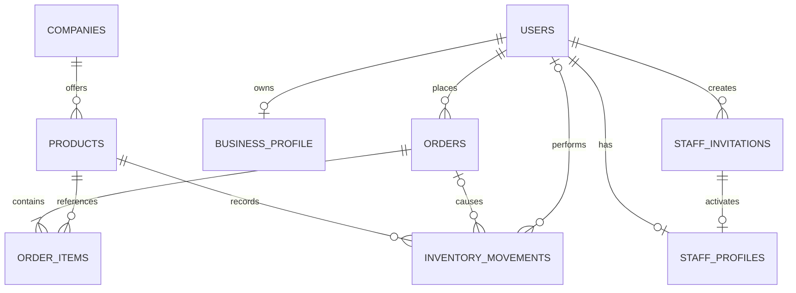
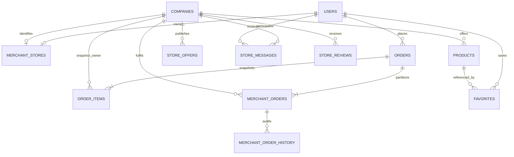
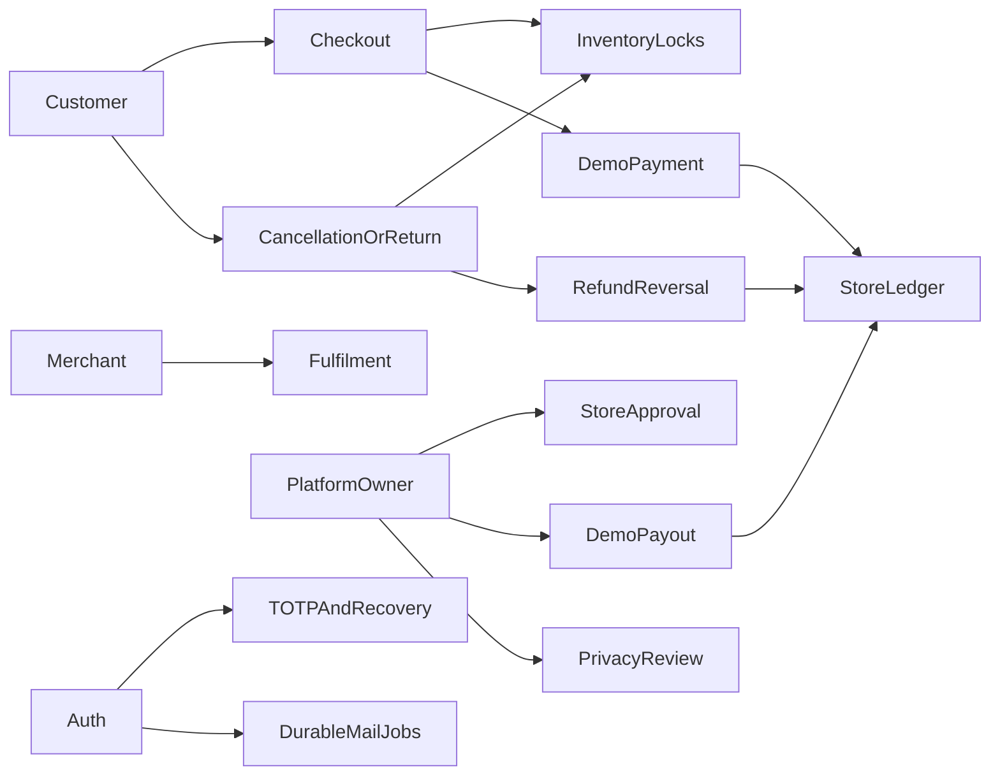

> Current marketplace scope and gap audit: [REQUIREMENTS_AUDIT_HE.md](../REQUIREMENTS_AUDIT_HE.md). Merchant ownership, mixed-order fulfilment and announcement visibility are detailed in MARKETPLACE_CONTRACT.md and DISCOVERY_NAVIGATION.md.

# Architecture decisions — current implementation

## Scope fixed for the first release

Hebrew/Arabic/English UI with RTL/LTR, ILS, whole item quantities, no product variants, simulated checkout only.
No card information, payment processing, tax invoice, email or shipping integration.
Order totals contain product prices only. Shipping details are stored as an order snapshot.
The storefront uses black, cream and champagne with original CSS illustrations until licensed product photos are selected.

## Components

React + TypeScript → same-origin `/api` proxy → Java 17 / Spring Boot → PostgreSQL.
One backend deployment with separate catalog, accounts, inventory and orders modules.
Flyway owns schema changes; Hibernate validates and never updates schemas automatically.
Docker Compose is for local demonstration, not a production hosting configuration.

## Implemented relationship model

COMPANIES, PRODUCTS, USERS, ORDERS, ORDER_ITEMS, INVENTORY_MOVEMENTS and ORDER_STATUS_HISTORY are implemented, alongside Flyway migration history. Demo catalog data is a repeatable Flyway migration with ON CONFLICT DO NOTHING, so later versioned migrations can run normally without resetting inventory. Product rows use an optimistic version and row locks for administrative edits and stock adjustments. See the feature contracts for implemented API details; local setup and recovery are documented in FRESH_SETUP.md and RECOVERY.md.

## Contracts fixed before implementing checkout

- Browser cart stores IDs and quantities. The server is the authority for prices and stock.
- Checkout requires authentication. Session cookies are HttpOnly; CSRF protection is required before adding state-changing endpoints.
- Lock product rows in ascending ID order; reject insufficient stock and commit order, items and movements atomically.
- Store the idempotency key and request fingerprint per user with a unique database constraint. Repeated identical requests return the original order. Changed payloads conflict.
- Copy SKU, name and unit price into order items. Money uses BigDecimal / NUMERIC(12,2), two decimal places.
- Legal state transitions: PENDING → SHIPPED → DELIVERED; PENDING → CANCELLED by admin only. Cancellation restores stock once in the same transaction.
- Client submits expected prices. Any price difference returns a conflict requiring confirmation of the new total.
- No deletion of historical products or orders. Deactivate products instead.
- Dashboard refresh: next request scheduled five seconds after the preceding request finishes, with a visible last-successful-update time; see DASHBOARD_CONTRACT.md.
- UTC storage; user-facing times explicitly formatted for Asia/Jerusalem.

## Current catalog API

`GET /api/products?search=&category=&sort=featured&page=0&size=12`

Response: `{ items: [{ id, sku, name, description, category, price, stockQuantity }], total, page, size }`.
Search is case insensitive and trimmed; maximum 100 characters. Optional category is Living, Wear, Accessories, Wellness, Makeup, Games or Other. Sort is featured (ID), price-asc, price-desc or name, with an ID tie-breaker. Page is zero based; size 1–48.

`GET /api/products/{id}` returns an active product, otherwise 404.
`GET /actuator/health` returns minimal health status (backend port only).
Public catalog endpoints remain read-only. Accounts/session endpoints are implemented as specified in AUTH_CONTRACT.md. Administrative product writes and stock history are implemented as specified in PRODUCT_ADMIN_CONTRACT.md. Basket behavior is implemented in the frontend as specified in CART_CONTRACT.md. `GET /api/products/lookup?ids=1,2` provides current public data for 1–50 requested IDs, omitting unknown/inactive or non-approved-store products. The server does not persist the browser basket or reserve stock. Checkout/order endpoints are implemented as specified in ORDER_CONTRACT.md; administrator status transitions, history and stock restoration are specified in ADMIN_ORDER_CONTRACT.md.

## Quality gates

Unit/MVC tests: `mvn test`. Real PostgreSQL integration tests: `mvn verify -Pintegration` (Docker or explicit TEST_DB_* connection).
Frontend: `npm test` compiles the pure TypeScript basket model and runs Node's built-in test runner; `npm run build` includes strict TypeScript checking. Selenium Java/JUnit now covers isolated customer, merchant, platform-owner and employee journeys; see automation/README.md.
Do not count test compilation as a passing integration test. Do not mark future features complete.

## Marketplace relationships added in V8/V9

The application remains one modular backend deployment, not independent microservices. A confirmed checkout clears only its completed client request key; uncertain retries retain the original key. Favorite mutations serialize per customer. Application restart leaves PostgreSQL running; explicit Stop-Local can still stop all local services.

## Account lifecycle (V10)

`users.email_verified` starts false for existing and new users; `auth_version` is compared on authenticated requests and increased on password reset. `account_tokens` stores only token hashes, user ownership, purpose, creation/expiry/consumption timestamps. Requests are queued with bounded in-memory workers; consumption and issuance share the user row lock. See [account security](ACCOUNT_SECURITY_HE.md) for API flows, non-durable queue limitations and SMTP/demo configuration.

## Connected portfolio completion (V11–V16)

Checkout locks the active buyer, products in ID order and then companies in ID order; locked store approval is rechecked before order creation. Closure locks the account/store before checking open orders. Returns and platform cancellation lock the parent order before products and company/finance updates. Unique request/event keys make stock restoration, journal reversals and payout retries safe.

New tables: account_mfa, mfa_recovery_codes, privacy_requests, media_assets, demo_payments, return_requests, demo_ledger, demo_subscriptions, account_mail_jobs and demo_payouts. Secrets stay outside source; TOTP secrets are authenticated-encrypted and mail/auth tokens are hashed. Uploaded rasters live in PostgreSQL and are re-encoded before publication.

[Current completion contract and boundaries](PORTFOLIO_RELEASE_HE.md). Payment/provider, legal identity and public hosting remain external integration work; the simulated ledger is never presented as real collected revenue.
