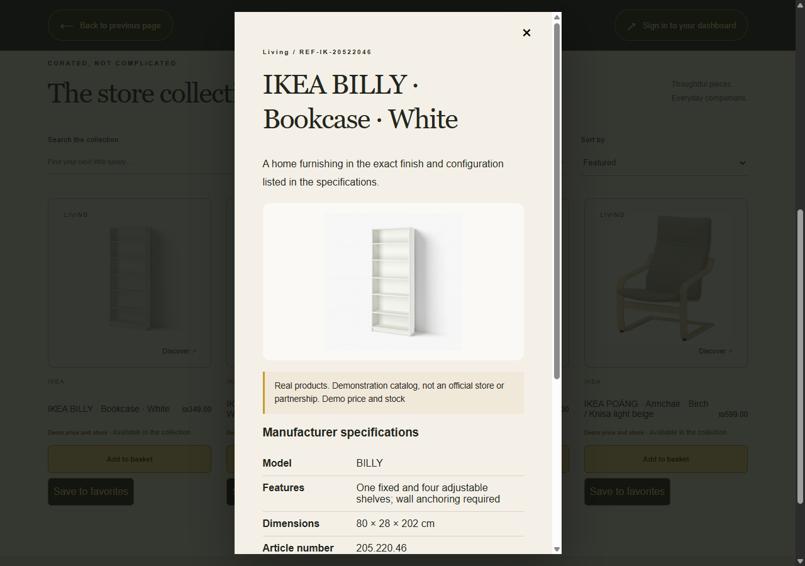

# Manufacturer reference catalog

Verified on 2026-11-05: **5 brands, 20 actual product models**, four per brand:

- Apple: iPhone 15 128GB, MacBook Air 13 M3 (2024) 8GB/256GB, iPad 10th generation Wi-Fi 64GB, AirPods Pro 2 USB-C.
- Sony: WH-1000XM5, WF-1000XM5, WH-CH720N, SRS-XB100.
- Logitech: MX Master 3S Bluetooth Edition, MX Keys S US layout, Lift right-handed, Brio 500.
- LEGO: 10313, 10311, 10281, 10329.
- IKEA Israel: BILLY 205.220.46, KALLAX 202.758.14, LACK 304.499.08, POÄNG 392.407.87.

`manufacturer-products.json` records the exact official page, original image URL, selected configuration, specifications and verification date for each product. Descriptions are short factual summaries, not copied manufacturer marketing text. Some photos show the manufacturer's available colors; the configuration in the specification is authoritative. Published battery runtimes are manufacturer maximums, not guarantees.

## Demo commerce versus real identity

These brands have **not joined Mavelle**. Their pages are manufacturer reference catalogs, not official stores, authorized dealer claims, paid advertisements or commercial partnerships. The UI labels them accordingly in English, Hebrew and Arabic. All ILS prices and quantities are synthetic demonstration values. There is no live price, availability, delivery, warranty or payment integration with these companies. Checkout continues to use the existing simulated commerce workflow.

## Running and preserving data

`scripts/Start-Local.ps1` enables `demo,real-catalog`. For manual startup use `SPRING_PROFILES_ACTIVE=demo,real-catalog`. The optional `real-catalog` profile adds `db/real-catalog` to Flyway's locations. Ordinary `demo` test fixtures remain the original four products and three fictional stores.

V17 adds nullable manufacturer source/image/date fields and JSONB specifications. The repeatable seed adds companies by slug and products by unique SKU with `ON CONFLICT DO NOTHING`. It never resets stock, prices, existing product edits, accounts or orders. Old company/product IDs are preserved. Original demo fixtures remain available. Featured sorting prioritizes reference products; each company's own catalog stays filtered by company ID.

To change curated seed data, update both the SQL and this provenance manifest. Existing rows are deliberately not overwritten: review an explicit data migration for changes to installed catalogs. Never delete or reset a user's database to refresh seed data.

## Product image attribution

The files under `frontend/public/catalog` are matching manufacturer product photographs, fetched from the official URLs in the manifest and stored locally so browsing does not depend on third-party image servers. No AI-generated substitutes are used.

- Apple photos and trademarks © Apple Inc.
- Sony photos and trademarks © Sony Corporation / Sony Group.
- Logitech photos and trademarks © Logitech.
- LEGO photos and trademarks © The LEGO Group.
- IKEA photos and trademarks © Inter IKEA Systems B.V.

These are third-party assets, not original Mavelle artwork or assets licensed under any project code license. Attribution does not grant an open reuse license; none was established during this task. The current project remains a private local portfolio demonstration. Obtain appropriate image/brand permissions or replace assets with licensed alternatives before commercial redistribution or public marketing.

## Verification

`ManufacturerCatalogIT` starts an isolated PostgreSQL schema with both demo profiles. It checks all five companies, all twenty models, per-company filtering, specification/detail serialization, featured placement, model search, preservation of original fixtures and non-destructive reseeding after stock/price edits. Frontend tests check the demo disclosure, official source link, accessible detail photo and failed-photo fallback. Product photos are also decoded and visually inspected as a contact sheet.
